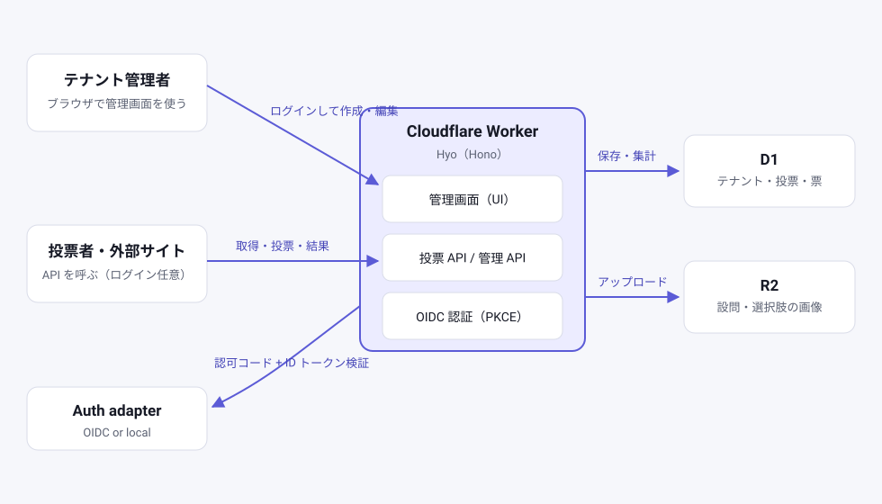

# headless-vote

Headless な投票 SaaS です。
投票の作成と管理はブラウザの管理画面で行います。
投票の取得・実行・結果は JSON の API で提供します。
複数の利用者（テナント）が、それぞれ自分の投票を運用できます。


## 構成



- Cloudflare Workers（Hono / TypeScript）
- D1（テナント・投票・票のデータ）
- R2（設問・選択肢の画像）
- 管理画面のログインは 0g0-id（OIDC、認可コード + PKCE）
- 本番ドメインは https://vote.0g0.xyz

## 概念

### テナント（ワークスペース）

利用者ごとの作業単位です。テナント同士のデータは混ざりません。
テナントを作ると管理用 API キーが 1 回だけ表示されます。
API キーは SHA-256 ハッシュで保存します。平文は保存しません。

管理操作の認証は 2 通りです。

- 管理画面: 0g0-id でログインし、セッション Cookie で認証します。
  ログインしたユーザー（sub）がメンバーであるテナントだけを操作できます。
- 管理 API: `Authorization: Bearer <API キー>` で認証します。

### 投票者

投票はログインしてもしなくてもできます。

- ログイン時: 0g0-id の ID トークン（`Authorization: Bearer <ID トークン>`）を送ります。
  1 人 1 票の判定はユーザー（sub）単位です。
- 未ログイン時: 投票者トークン（任意の不透明な文字列）を送ります。
  判定はトークン単位です。トークンそのものは保存されず、サーバ側では
  HMAC ハッシュとしてのみ保持されます。

ログインした状態で、以前の匿名投票と同じ `voter_token` を送ると、
匿名の票はログイン側の票に寄せられ、二重に数えられません。

再投票すると上書きされます。締切後は投票できません。
投票ごとに「ログイン必須」か「誰でも投票可」かを選べます。既定は「誰でも投票可」です。

匿名投票の限界: トークンを変えた同一人物は別人として数えられます。
匿名のままでは同一人物かどうかを判定できないためです。
厳密に 1 人 1 票が必要な投票では「ログイン必須」を選んでください。

注意: 0g0-id の sub はクライアントごとに変わります（pairwise）。
このアプリの ID トークンで投票した票は、このアプリの sub に紐付きます。

## 制限とセキュリティ

濫用を防ぐため、Worker 側で次の制限を入れています（固定ウィンドウ方式、
超過時は `429` と `Retry-After` を返します）。

| 対象 | 制限 |
|---|---|
| テナント作成（未認証） | 送信元 IP ごとに 30 回 / 時 |
| ワークスペース作成（画面） | ユーザーごとに 30 回 / 時 |
| ログイン開始 | 送信元 IP ごとに 60 回 / 時 |
| 投票 | 投票 × 送信元 IP ごとに 600 回 / 時 |
| 画像アップロード | テナントごとに 120 回 / 時 |
| API キー再発行 | テナントごとに 30 回 / 時 |
| 画像クォータ | テナントごとに 500 件まで、合計 500 MiB まで（1 件 5 MiB、形式は PNG / JPEG / WebP / GIF のみ。実体バイトで検証します） |

そのほかの対策:

- 管理画面のセッションはサーバ側（D1）で保持し、ログアウトや
  「すべてのセッションを無効化」で即時に失効できます。
- 管理画面の変更操作には CSRF トークンが必須です。
- レスポンスには Content-Security-Policy などのセキュリティヘッダを
  Worker 自身が付けます。
- 匿名投票の投票者トークンは HMAC ハッシュでのみ保存されます
  （旧形式の平文キーは、投票・集計のタイミングで自動的に移行されます）。

## API 仕様

ベース URL は `/api/v1` です。
エラーはすべて同じ形で返します。

```json
{ "error": { "code": "POLL_CLOSED", "message": "This poll is closed for voting." } }
```

主なエラーコード: `VALIDATION_ERROR`（400）、`UNAUTHORIZED`（401）、
`LOGIN_REQUIRED`（401、ログイン必須の投票に未ログインで投票）、
`INVALID_TOKEN`（401）、`FORBIDDEN`（403）、`NOT_FOUND`（404）、
`POLL_CLOSED`（409）、`OPTIONS_LOCKED`（409、投票が入った投票の選択肢は変更不可）、
`PAYLOAD_TOO_LARGE`（413）、`RATE_LIMITED`（429）、
`IMAGE_QUOTA_EXCEEDED`（429、テナントの画像クォータ超過）。

### テナント管理（要 API キー、作成のみ認証不要）

| メソッド | パス | 内容 |
|---|---|---|
| POST | `/tenants` | テナント作成。API キーを返す（1 回だけ） |
| POST | `/tenants/:tenantId/rotate-key` | API キーの再発行 |

### 投票の管理（要 API キー、または管理画面のセッション）

| メソッド | パス | 内容 |
|---|---|---|
| POST | `/tenants/:tenantId/polls` | 投票を作成（下書き） |
| GET | `/tenants/:tenantId/polls` | 一覧 |
| GET | `/tenants/:tenantId/polls/:pollId` | 1 件取得 |
| PATCH | `/tenants/:tenantId/polls/:pollId` | 編集（締切済みは不可） |
| POST | `/tenants/:tenantId/polls/:pollId/status` | 状態変更（`published` / `closed` / `draft`） |
| GET | `/tenants/:tenantId/polls/:pollId/results` | 結果 |
| POST | `/tenants/:tenantId/images` | 画像アップロード（R2）。本文に画像バイナリ、対応形式は PNG / JPEG / WebP / GIF、5 MiB まで |

投票の作成リクエスト例:

```json
{
  "question": "好きな季節は？",
  "description": "1 つ選んでください",
  "image_key": "t/<tenantId>/<uuid>.png",
  "allow_multiple": false,
  "require_login": false,
  "closes_at": "2026-12-31T15:00:00.000Z",
  "options": [
    { "label": "春" },
    { "label": "夏", "image_key": "t/<tenantId>/<uuid>.png" }
  ]
}
```

### 公開 API（投票者向け）

| メソッド | パス | 内容 |
|---|---|---|
| GET | `/polls/:pollId` | 投票の取得（下書きは 404） |
| GET | `/polls/:pollId/results` | 結果の取得 |
| POST | `/polls/:pollId/vote` | 投票の実行 |

投票リクエスト例（未ログイン）:

```json
{ "voter_token": "any-opaque-string-1234", "option_ids": ["<optionId>"] }
```

ログイン時は `voter_token` の代わりに `Authorization: Bearer <ID トークン>` を付けます。
レスポンスには、記録された票と最新の集計が入ります。

画像は `GET /images/t/<tenantId>/<file>` で配信します。
投票の JSON では `image_url` として絶対 URL が返ります。

## 管理画面

- `/admin` から 0g0-id でログインします。
- ワークスペースの作成、投票の作成・編集・公開・締切ができます。
- 設問と選択肢に画像を付けられます（R2 にアップロード）。
- 結果はバーと集計表で確認できます。

### 0g0-id のクライアント登録

認可コードフロー（PKCE S256、パブリッククライアント）を使います。
クライアントは DCR（RFC 7591）で登録できます。

```bash
node scripts/register-oidc-client.mjs
# 既定のリダイレクト URI: https://vote.0g0.xyz/auth/callback
```

表示された `client_id` を `wrangler.toml` の `OIDC_CLIENT_ID` に設定して再デプロイします。
ローカル開発では `REDIRECT_URI=http://localhost:8787/auth/callback` を付けて登録します。

必要な設定:

- 変数: `OIDC_ISSUER`（既定 `https://id.0g0.xyz`）、`OIDC_CLIENT_ID`、`OIDC_SCOPES`（既定 `openid profile email`）
- シークレット: `SESSION_SECRET`（セッション Cookie の署名用。`wrangler secret put SESSION_SECRET`）

## ローカル開発

```bash
npm install --legacy-peer-deps
npm run db:migrate:local
npm run dev          # http://localhost:8787
npm test             # vitest（Workers ランタイム + モック IdP）
npm run typecheck    # tsc（アプリ + テスト）
```

テストは IdP をモックします。実ログインは不要です。

## デプロイ

### 手動デプロイ

```bash
npx wrangler d1 create headless-vote          # 出力された database_id を wrangler.toml に記入
npx wrangler r2 bucket create headless-vote-images
npx wrangler secret put SESSION_SECRET
npx wrangler d1 migrations apply headless-vote --remote
node scripts/register-oidc-client.mjs          # client_id を wrangler.toml に記入
npx wrangler deploy                            # vote.0g0.xyz のカスタムドメインが付きます
```

### GitHub 連携の自動デプロイ（Workers Builds）

main へ push すると自動でデプロイされる構成にできます。
Cloudflare ダッシュボードで 1 回だけ設定します。

1. Workers & Pages → `headless-vote` → Settings → Builds
2. Git リポジトリ `g-kari/headless-vote` を接続し、本番ブランチを `main` にする
3. ビルドコマンド: `npm ci --legacy-peer-deps`
4. デプロイコマンド: `npx wrangler d1 migrations apply headless-vote --remote && npx wrangler deploy`

デプロイコマンドにマイグレーション適用を含めるので、push のたびに D1 へ自動で当たります。

## 依存関係の更新

Renovate と Dependabot を併用します。担当を分けているので競合しません。

- Renovate（`renovate.json`）: 主担当。通常の npm / GitHub Actions 更新を扱い、CI が通れば自動マージします（major は手動確認）。
- Dependabot（`.github/dependabot.yml`）: セキュリティ更新の担当。通常更新は Renovate に任せます。Dependabot の PR は `.github/workflows/dependabot-automerge.yml` が自動マージを有効化し、CI 成功後に取り込みます。

main ブランチは CI（`check`）の成功を必須にしているため、自動マージは CI が通ったものだけが進みます。

## 開発メモ

- 管理画面のデザインは `.claude/skills/modern-web-guidance` のガイダンスに沿っています。
  要点: ダークモードは `light-dark()` と `color-scheme`、確認はネイティブ `<dialog>`、
  表はキーボードでスクロールできるラッパーと sticky ヘッダー（狭い画面ではカード化）、
  エラーはライブリージョンで通知、入力エラー表示は `:user-invalid` で操作後にだけ出します。
- 構成図（`docs/architecture.svg`）と結果表示（バー + 集計表）は、
  `.claude/skills/visual-explainer` の考え方（図に動詞ラベル、数値には図と表の両方）に沿っています。
- ブランド画像は `public/` にあります。`favicon.svg` が正で、PNG / ICO / apple-touch-icon / OGP は同じ図形から生成しました。
